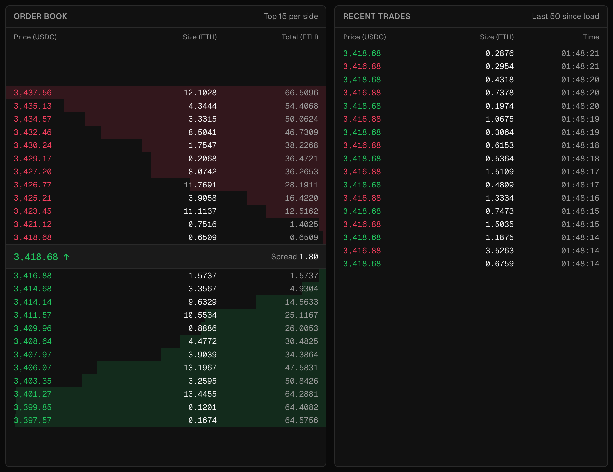
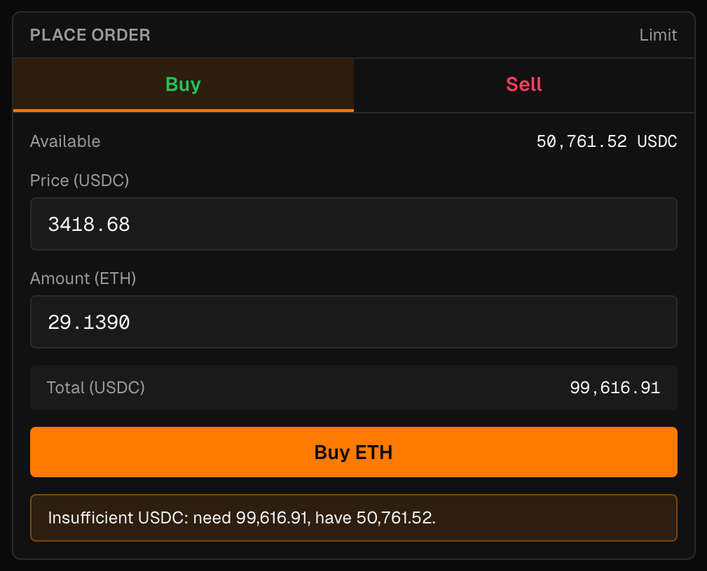
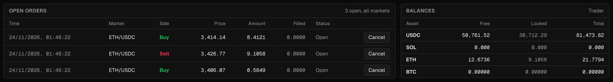

# crypto-exchange

a binance-shaped spot exchange with an in-memory matching engine, live market data over websockets and a trading ui.

## How it works

[![Architecture diagram. A browser running the Next.js web app on port 3000 sends REST requests to the api process on port 4000. Inside the api process, numbered arrows follow one order: routes parse the request, the order service reserves funds in Postgres in a first transaction, the matching engine matches synchronously and mutates its in-memory order book, a second Postgres transaction persists orders and trades and settles balances, then the order service hands trade and depth events to the streaming service with a dashed arrow marked not awaited and returns 201 with the fills. The streaming service produces to the Kafka topics trade-events and depth-events, the websocket gateway inside the same process consumes them and pushes each event to subscribed browser sockets. Dotted arrows show the boot-time rebuild of the books from resting orders in Postgres and the Redis ping used only by the health check.](apps/docs/diagrams/architecture.png)](apps/docs/diagrams/architecture.png)

- The browser calls the REST API on port 4000 and names the account with an `X-Account-Id` header. There is no login.
- The route validates the body with the shared zod schema, then the order service moves the order's cost from free to locked in one Postgres transaction.
- The market's in-memory book matches the order synchronously, with no await, and rests any remainder.
- A second transaction updates the makers, writes the order and its trades, and settles both sides' balances.
- After that commit the streaming service publishes trade and depth events to Kafka without awaiting them, and the API answers 201 with the fills.
- A websocket gateway in the same process and port consumes both topics and sends each event to sockets on `/ws/<SYMBOL>@trade` or `/ws/<SYMBOL>@depth`.
- On boot the API rebuilds every book from resting orders in Postgres. Redis is only pinged by `GET /health`.
- A pnpm and Turborepo monorepo on Node 24: `apps/api` (Express 5, Prisma 7, Kafka through `@confluentinc/kafka-javascript`, `ws`), `apps/web` (Next.js 16, React 19, Tailwind 4, Redux Toolkit) and `packages/shared` (zod 4 schemas).

## Order status

[![Order status diagram. A POST to /api/v3/order becomes NEW when nothing fills, PARTIALLY_FILLED when some of it fills, or FILLED when it fills completely on arrival. NEW and PARTIALLY_FILLED are grouped as resting in the book. A NEW order becomes PARTIALLY_FILLED when a taker fills part of it, and a PARTIALLY_FILLED order can take more fills. Either resting state becomes FILLED when its remaining quantity reaches zero, or CANCELED through DELETE /api/v3/order. FILLED and CANCELED are final, and canceling them returns 404 order_not_found.](apps/docs/diagrams/order-status.png)](apps/docs/diagrams/order-status.png)

## Trading guarantees

- A trade always executes at the resting order's price.
- Price-time priority: levels are kept in price order, orders at one level fill first in first out, and the boot rebuild re-adds resting orders oldest first.
- Funds move from free to locked before matching: price times quantity of USDC for a buy, the quantity of the base asset for a sell. An order that cannot be covered fails with `insufficient_funds` and never reaches the book.
- A buy taker locks at its limit price and pays the maker's price, so any difference goes back to free.
- Cancel releases the order's remaining locked amount to the account that placed the order.
- Depth events carry the new total quantity at a price level, and `"0.00000000"` removes the level.
- Events are at most once: they are published after commit, not awaited, and a failed publish is only logged. Clients refetch the depth snapshot on every websocket open or reconnect and every 30 s.

## Key design decisions

| Decision | Reason |
| --- | --- |
| In-memory book with synchronous matching | Matching and the book update run with no await between them, so two orders in the same process can never interleave mid-match. |
| Atomic conditional update for reservations | `UPDATE ... WHERE free >= amount` lets the Postgres row lock decide, so two concurrent orders cannot spend the same balance. |
| Publish after commit, not awaited | Nothing that could still roll back is broadcast, and a Kafka problem never fails or slows an order. |
| Kafka between the API and the gateway | Messages are keyed by symbol, so one market's events stay in order, and websocket fan-out is decoupled from the order path. |
| Decimal strings on the wire | Prices and quantities never pass through binary floats: the API uses `decimal.js` and `Decimal(18,8)` columns, and the web app uses `decimal.js` too. |
| Level totals in depth events | A client applies an update by replacing the level, so applying the same update twice leaves the same book. |
| Binance-shaped API | Paths, fields and event keys follow Binance spot (`/api/v3/order`, `origQty`, `depthUpdate`), so the shapes are already familiar. |

## Trading UI

Open `http://localhost:3000`, which redirects to `/trade`. The screenshots use seeded local test data.

[](apps/docs/screenshots/trade.png)

The trading page with the order book, live trades, order form, open orders and balances on one screen.

[](apps/docs/screenshots/order-book.png)

The book shows the top 15 levels per side with cumulative size bars, and the trade feed fills from the websocket since page load.

[](apps/docs/screenshots/order-form-error.png)

API errors appear inline under the form, here the `insufficient_funds` response for a buy larger than the free USDC.

[](apps/docs/screenshots/open-orders.png)

Open orders for the active account across all markets, each with a cancel button, next to free and locked balances.

[](apps/docs/screenshots/accounts.png)

There is no auth, so the account menu keeps labeled account ids in localStorage, creates funded test accounts and accepts a pasted id.

## Run it locally

```bash
cp apps/api/.env.example apps/api/.env
cp apps/web/.env.example apps/web/.env.local
pnpm install
docker compose up -d postgres redis kafka
pnpm --filter api db:generate
pnpm --filter api db:migrate
pnpm --filter @repo/shared build
pnpm dev
```

Web runs on port 3000 and the API on port 4000. The API only allows CORS from `http://localhost:3000`. `pnpm dev` does not build `@repo/shared`, so rebuild it after changing its schemas. Do not start the compose `web` service for local development.

To trade, open the account menu in the header, create a test account with starting balances, then create a second one. Switch between them, or use two browser windows, to place crossing orders.

`pnpm --filter web screenshots` regenerates the screenshots above. It needs the API running and at least one market with an empty book, seeds that market through the API, builds and starts the web app, and stops it when done.

## Known limitations

- Depth events have no sequence ids, so clients cannot detect a missed update and refetch the snapshot every 30 s instead.
- There is no recent-trades endpoint, so the trade feed starts empty on page load.
- There is no user stream, so the web app polls open orders and balances every 3 s.
- There are no candles.
- There is no auth. Any caller can act as any account id.
- Cancel has no ownership check, so any account can cancel any order by id.

## Design docs

Design docs for each feature live in `apps/docs`: [order matching](apps/docs/order-matching-docs), [place order](apps/docs/place-order-docs%202), [cancel order](apps/docs/cancel-order-docs), [balances](apps/docs/balances-docs), [order lookup](apps/docs/order-lookup-docs), [realtime streaming](apps/docs/realtime-streaming-docs) and [frontend](apps/docs/frontend).
